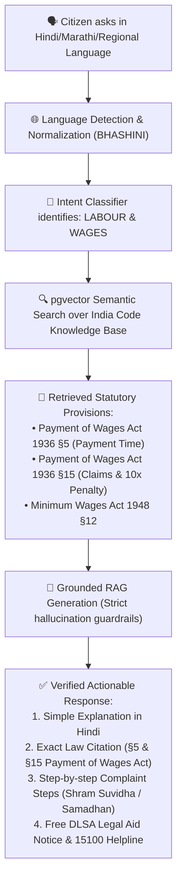

# NyayaSaathi (न्यायसाथी) — Digital Assistant for Legal Awareness & Know Your Rights (KYR) Framework

[](https://opensource.org/licenses/MIT)
[](https://www.typescriptlang.org/)
[](https://reactjs.org/)
[](https://nodejs.org/)
[](https://fastapi.tiangolo.com/)
[](https://www.postgresql.org/)
[](https://github.com/pgvector/pgvector)
[](https://bhashini.gov.in/)

> **One platform. Every citizen. Every right. Every language.**  
> An AI-powered legal awareness companion making Indian law accessible, understandable, and actionable for every citizen in their native language.

---

## ⚖️ Core Product Vision

In India, ordinary citizens often face profound barriers when seeking legal remedies:
- **Intimidating legal language** written in colonial-era or complex statutory terms.
- **Absence of awareness** regarding which specific laws protect them.
- **Unclear grievance channels** (not knowing whether to approach the Labour Commissioner, Consumer Forum, Magistrate, or Police).
- **Prohibitive lawyer fees** and lack of awareness that **over 70% of Indian citizens qualify for 100% free legal aid** under **Section 12 of the Legal Services Authorities Act, 1987**.
- **Linguistic isolation** for non-English speakers.

> 💡 **Important Distinction**: In this framework, **KYC means *Know Your Rights*** — empowering citizens with legal literacy and remedy pathways, distinct from the financial industry's "Know Your Customer" verification.

---

## 🏛️ The Five Core Modules

| Module | Purpose | Statutory Foundation |
|---|---|---|
| **🤖 AI Legal Assistant** | Conversational legal Q&A in regional languages with grounded RAG, zero section hallucinations, and actionable next steps. | Indian Evidence Act, Central Acts, Constitution of India |
| **📜 Know Your Rights Library** | Side-by-side view comparing original statutory text from India Code with simplified 5th-grade reading summaries. | Central & State Acts, Gazette Notifications |
| **🧭 Legal Action Navigator** | Step-by-step grievance workflows, document checklists, timelines, and statutory authority routing. | Samadhan, e-Daakhil, CPGRAMS, PWDVA Procedures |
| **🤝 Legal Aid Finder** | Real-time directory of NALSA, SLSA, and DLSA clinics with one-tap dialing to the **15100** national helpline. | Legal Services Authorities Act, 1987 |
| **📋 Document & Eligibility Assistant** | Instant assessment verifying whether a citizen is entitled to a free court lawyer under Section 12 criteria. | NALSA Section 12(a)-(h) Statutory Guidelines |

---

## 👤 Real-World User Journey: The Maharashtra Worker

```
Citizen Query (Hindi):
"Mere employer ne 3 mahine se salary nahi di. Main kya kar sakta hoon?"
("My employer hasn't paid my salary for 3 months. What can I do?")
```



---

## 🧱 System Architecture

```
                    ┌──────────────────────────────────────────┐
                    │          USER INTERFACES                 │
                    │  Desktop · Mobile PWA · Voice STT/TTS    │
                    └────────────────────┬─────────────────────┘
                                         │
                    ┌────────────────────▼─────────────────────┐
                    │    MULTILINGUAL LAYER (BHASHINI API)     │
                    │   Language Detection · Translation · STT │
                    └────────────────────┬─────────────────────┘
                                         │
          ┌──────────────────────────────┴──────────────────────────────┐
          │                                                             │
┌─────────▼──────────────────────────┐      ┌───────────────────────────▼────────┐
│     NODE.JS / EXPRESS BACKEND      │      │     PYTHON FASTAPI AI ENGINE       │
│  • REST APIs & Route Aggregation   │◄────►│  • Intent Classification           │
│  • Authentication (JWT & bcrypt)   │      │  • Multilingual Vector Embeddings  │
│  • Prisma ORM Data Layer           │      │  • Grounded RAG Pipeline           │
│  • NALSA Section 12 Engine         │      │  • Statutory Prompt Guardrails     │
└─────────────────┬──────────────────┘      └─────────────────────┬──────────────┘
                  │                                               │
                  └───────────────────────┬───────────────────────┘
                                          │
                         ┌────────────────▼────────────────┐
                         │   POSTGRESQL + PGVECTOR DB      │
                         │  • Acts, Sections, Amendments   │
                         │  • Beneficiaries & Rights Graph │
                         │  • 384-dim Semantic Vectors     │
                         │  • DLSA / SLSA Directory        │
                         └─────────────────────────────────┘
```

---

## 🗄️ Relational Knowledge Graph (PostgreSQL + Prisma)

The legal data schema decouples original legislative text from simplified plain-language explanations to guarantee source integrity:

```prisma
model LegalAct {
  id           String          @id @default(cuid())
  title        String          // e.g. "Payment of Wages Act, 1936"
  actNumber    String?         // e.g. "Act No. 4 of 1936"
  year         Int
  jurisdiction String          // "CENTRAL" | "STATE"
  state        String?         // e.g. "Maharashtra"
  category     String          // "LABOUR", "WOMEN", "CRIMINAL", etc.
  sourceUrl    String          // India Code canonical link
  sections     LegalSection[]
}

model LegalSection {
  id              String               @id @default(cuid())
  sectionNumber   String               // e.g. "Section 5"
  title           String?
  originalText    String               @db.Text // Authentic Gazette Clause
  simplifiedText  String               @db.Text // Plain-language Explanation
  rights          SectionRight[]
  beneficiaries   SectionBeneficiary[]
  remedies        LegalRemedy[]
}

model Beneficiary {
  id          String   @id @default(cuid())
  name        String   @unique // "Workers", "Women", "SC/ST", "Children"
  slug        String   @unique
  description String
}

model ComplaintWorkflow {
  id          String          @id @default(cuid())
  category    String          // "LABOUR", "DOMESTIC_VIOLENCE"
  title       String
  steps       ComplaintStep[]
}
```

---

## ⚡ Technology Stack

| Layer | Technologies | Purpose |
|---|---|---|
| **Frontend** | React 18, Vite, Tailwind CSS, Lucide Icons, React Router v6, i18next | Responsive, high-contrast, Indian-accessible UI (Saffron/Green accents). |
| **Backend** | Node.js, Express, TypeScript, Prisma ORM, Helmet, Winston | High-throughput API gateway, session tracking, and legal aid workflows. |
| **Database** | PostgreSQL 16 + `pgvector` extension | Relational legal schema + vector similarity indexing in a single unified database. |
| **AI Engine** | Python 3.11, FastAPI, LangChain, Pydantic, Uvicorn | RAG retrieval, intent classification, and strict legal hallucination filters. |
| **Embedding Model** | `paraphrase-multilingual-MiniLM-L12-v2` | Open-source 384-dim embeddings covering Hindi, Tamil, Bengali, Marathi, and 50+ languages. |
| **Language AI** | Digital India BHASHINI API & Web Speech STT | Indian language translation and voice input for non-literate citizens. |

---

## 🚀 Getting Started

### 1. Clone the Repository
```bash
git clone https://github.com/shivamyadav17062006-code/nayaya-setu-ai.git
cd nayaya-setu-ai
```

### 2. Configure Environment Variables
```bash
cp .env.example .env
cp backend/.env.example backend/.env
cp ai-engine/.env.example ai-engine/.env
```

### 3. Create the Supabase Schema
Run [`supabase/schema.sql`](./supabase/schema.sql) in the Supabase SQL Editor. See
[`supabase/README.md`](./supabase/README.md) for the full walkthrough.

The script creates the 10 legal tables, RLS policies, the HNSW vector index, the
`match_legal_chunks()` RPC, and verified seed provisions. It is idempotent — safe
to re-run after updates.

```bash
# Confirm the tables and RPC are reachable from the backend
npm run db:check
```

*Optional local alternative:* `docker-compose up -d` starts PostgreSQL 16 with
`pgvector` on port 5432 and pgAdmin on port 5050, then run the same SQL against it.

### 4. Install Dependencies & Generate Embeddings
```bash
npm install

# Generate pgvector embeddings for the seeded legal sections
cd ai-engine
python -m venv venv
source venv/bin/activate
pip install -r requirements.txt
python embedding.py       # add --force to re-embed existing sections
```

### 5. Run All Three Services
```bash
# From the repository root — starts the AI engine, backend and frontend
npm run dev:full
```

Or run them individually:

```bash
npm run dev:ai   # FastAPI AI engine on :8001
npm run dev      # Express backend on :8000 + Vite frontend on :3000
```

- **Frontend App**: `http://localhost:3000`
- **Backend API**: `http://localhost:8000/api`
- **AI Engine Docs**: `http://localhost:8001/docs`

---

## 📡 REST API Reference

| Method | Endpoint | Description |
|---|---|---|
| `POST` | `/api/chat` | Main conversational legal query endpoint |
| `GET` | `/api/rights` | List statutory right categories with section counts |
| `GET` | `/api/rights/:slug` | Retrieve provisions and acts under a category |
| `GET` | `/api/rights/search?q=` | Full-text statutory search |
| `GET` | `/api/workflows` | List all legal action navigator workflows |
| `GET` | `/api/workflows/:category` | Get step-by-step complaint procedures for a grievance |
| `GET` | `/api/aid?state=&category=` | Query NALSA/SLSA/DLSA legal aid directory |
| `POST` | `/api/eligibility` | Evaluate NALSA Section 12 free lawyer qualification |
| `POST` | `/api/auth/register` | Citizen / paralegal account registration |
| `POST` | `/api/auth/login` | Citizen / paralegal login |

---

## 🏛️ Grounded Verification Sources

NyayaSaathi indexes and grounds its knowledge in authentic official repositories:
1. **[India Code](https://www.indiacode.nic.in)** — Central and State Acts repository.
2. **[NALSA](https://nalsa.gov.in)** — National Legal Services Authority guidelines and Section 12 categories.
3. **[e-Daakhil Portal](https://edaakhil.nic.in)** — National Consumer Disputes Redressal Commission.
4. **[SAMADHAN / Shram Suvidha](https://shramsuvidha.gov.in)** — Ministry of Labour & Employment dispute resolution.
5. **[Digital India BHASHINI](https://bhashini.gov.in)** — Government of India National Language Translation Mission.

---

## 📜 Legal Disclaimer

NyayaSaathi is an open educational and legal literacy platform. Information provided does not constitute formal legal counsel or create an advocate-client relationship under the Advocates Act, 1961. Citizens in active disputes are guided directly to NALSA (Helpline **15100**) or empanelled District Legal Services Authorities for free representation.

---

## 📄 License

Distributed under the **MIT License**. Free for social-impact, hackathon, and educational deployment.
