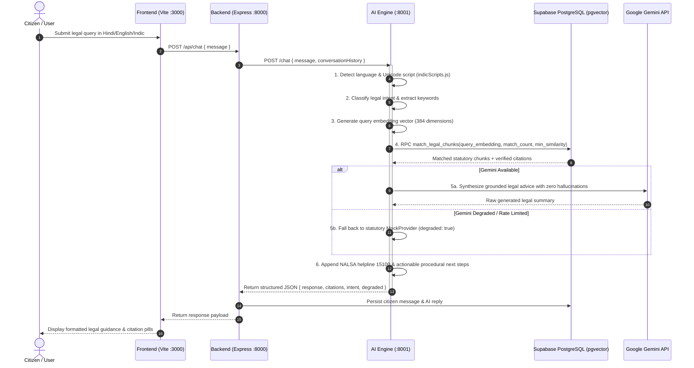

# NyayaSaathi (न्यायसाथी) — AI Engine Architecture

## 1. Overview & Architectural Principles

The **NyayaSaathi AI Engine** is a dedicated, high-performance Node.js microservice running on port `8001`. Built completely with modern JavaScript ES Modules (`import`/`export`), it fulfills the core Know Your Rights (KYR) mission: grounding citizen legal inquiries strictly in verified Indian statutes with zero hallucinations.

In accordance with `AGENTS.md`:
1. **Primary Language**: 100% JavaScript (Node.js ES Modules). No Python, FastAPI, or TypeScript runtimes.
2. **Official SDK**: Google Gemini JavaScript SDK (`@google/genai`).
3. **Single Source of Truth**: Supabase PostgreSQL + `pgvector` via the RPC function `public.match_legal_chunks`.
4. **Resilient Provider Fallback**: Pluggable provider architecture with automatic graceful degradation to statutory fallback models if Gemini credentials or quotas fail.
5. **Zero Legal Hallucinations**: Responses are strictly synthesized against verified statutory citations (Payment of Wages Act 1936, PWDVA 2005, Consumer Protection Act 2019, Legal Services Authorities Act 1987, Constitution of India).
6. **Statutory Awareness Disclaimer**: Mandatory disclaimer directing citizens to NALSA (Helpline **15100**) or local District Legal Services Authorities (DLSA) for formal legal representation.

---

## 2. Directory Structure & Module Responsibilities

The AI service adheres to clean modular separation:

```text
ai-engine/
├── package.json               # Node.js workspace definition (port 8001)
├── src/
│   ├── index.js               # Service entrypoint, Express app & graceful shutdown
│   ├── config/
│   │   ├── env.js             # Environment loader & key sanitization
│   │   └── index.js           # Consolidated runtime configuration
│   ├── controllers/
│   │   ├── embeddingController.js   # Vector embedding endpoint handlers
│   │   ├── generationController.js  # Chat, query & RAG generation handlers
│   │   ├── healthController.js      # Health and readiness probe handlers
│   │   ├── languageController.js    # Indic language & translation handlers
│   │   └── searchController.js      # Vector similarity search handler
│   ├── middleware/
│   │   ├── errorHandler.js    # Centralized JSON error normalizer
│   │   └── validate.js        # Zod request schema validator middleware
│   ├── providers/
│   │   ├── baseProvider.js    # Abstract provider interface contract
│   │   ├── geminiProvider.js  # Official @google/genai SDK implementation
│   │   ├── mockProvider.js    # Grounded statutory fallback provider
│   │   └── providerManager.js # Provider lifecycle & resilient fallback manager
│   ├── routes/
│   │   ├── embed.js           # POST /embed
│   │   ├── health.js          # GET /health, GET /ready
│   │   ├── index.js           # Root router and endpoint discovery manifest
│   │   ├── language.js        # POST /detect-language, POST /translate
│   │   ├── query.js           # POST /chat, POST /query, POST /generate
│   │   └── search.js          # GET /search
│   ├── services/
│   │   ├── languageService.js # Script classification & legal term translation
│   │   └── ragService.js      # End-to-end RAG orchestrator & context grounding
│   ├── utils/
│   │   ├── indicScripts.js    # Unicode Indic script block matching (10 languages)
│   │   ├── prompts.js         # Zero-hallucination prompt templates & NALSA helpline
│   │   └── retry.js           # Exponential backoff retry & request timeout wrapper
│   └── validators/
│       └── index.js           # Zod validation schemas
```

---

## 3. Provider Abstraction Contract

The AI Engine isolates LLM provider mechanics behind a formal `BaseProvider` contract:

```javascript
export class BaseProvider {
  async generateText({ prompt, systemInstruction, temperature, maxTokens }) {
    throw new Error('generateText must be implemented by subclass');
  }

  async generateEmbedding(text) {
    throw new Error('generateEmbedding must be implemented by subclass');
  }

  async healthCheck() {
    throw new Error('healthCheck must be implemented by subclass');
  }
}
```

### Provider Implementations:
- **`GeminiProvider`**: Utilizes `@google/genai` with `GoogleGenAI({ apiKey })`. Features exponential backoff (`withRetry`), request timeouts (`withTimeout`), and structured error translation.
- **`MockProvider`**: High-availability deterministic fallback containing pre-indexed statutory guidance across Labour, Domestic Violence, Consumer, Criminal, Constitutional, and Property law.
- **`ProviderManager`**: Manages provider selection. When Gemini encounters network limits, quota exhaustion, or unconfigured keys, `ProviderManager` seamlessly routes to `MockProvider` while flagging the response with `degraded: true` and an explanatory warning.

---

## 4. End-to-End RAG Pipeline Flow



---

## 5. Indic Language Support & Unicode Processing

NyayaSaathi provides native multi-lingual detection across 10 official Indian language scripts without external API round-trips:

| Language | Code | Unicode Script Range | Sample Keyword Triggers |
| :--- | :--- | :--- | :--- |
| **Hindi** | `hi` | `\u0900-\u097F` (Devanagari) | क्या, मुझे, पगार, वेतन, पुलिस, अधिकार |
| **Marathi** | `mr` | `\u0900-\u097F` (Devanagari) | आहे, नाहीत, झाले, केले, पाहिजे, पगार |
| **Bengali** | `bn` | `\u0980-\u09FF` | আমার, অধিকার, পুলিশ, মজুরি |
| **Tamil** | `ta` | `\u0B80-\u0BFF` | சட்டம், உரிமை, சம்பளம் |
| **Telugu** | `te` | `\u0C00-\u0C7F` | చట్టం, హక్కు, జీతం |
| **Gujarati**| `gu` | `\u0A80-\u0AFF` | અધિકાર, પગાર, કાયદો |
| **Kannada** | `kn` | `\u0C80-\u0CFF` | ಹಕ್ಕು, ಕಾನೂನು, ಸಂಬಳ |
| **Malayalam**| `ml`| `\u0D00-\u0D7F` | അവകാശം, നിയമം, ശമ്പളം |
| **Punjabi** | `pa` | `\u0A00-\u0A7F` (Gurmukhi) | ਕਾਨੂੰਨ, ਅਧਿਕਾਰ, ਤਨਖਾਹ |
| **Odia**    | `or` | `\u0B00-\u0B7F` | ଅଧିକାର, ଆଇନ, ଦରମା |
| **English / Hinglish** | `en` | `\u0000-\u007F` (Latin) | legal, rights, wages, FIR, notice |

---

## 6. Security & Credential Isolation

1. **Zero Secret Leakage**: API keys (`GEMINI_API_KEY`, `GOOGLE_API_KEY`) are resolved strictly server-side.
2. **Key Sanitization**: System logs utilize `sanitizeApiKey()`: only the first 4 and last 4 characters are ever displayed (e.g., `AIza...9xQz`).
3. **Stateless AI Boundary**: The AI engine accepts conversation context statelessly and never reads or writes user password hashes or personal auth tokens.
