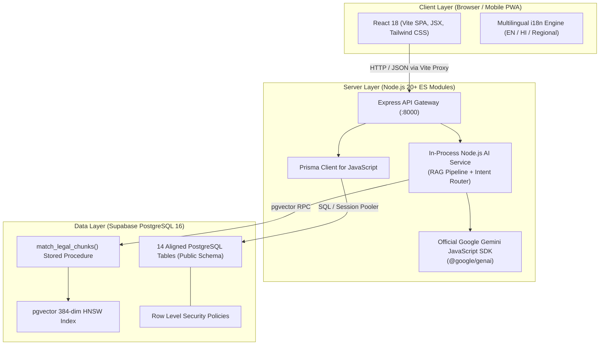

# NyayaSaathi (न्यायसाथी) — Target Architecture Specification

**Architecture Standard:** 100% JavaScript (ES Modules)  
**Target Runtime:** Node.js 20+ LTS / Modern Evergreen Browsers  
**Database:** Supabase PostgreSQL 16 with pgvector  
**LLM Engine:** Google Gemini official JavaScript SDK (`@google/genai`)

---

## 1. Architectural Vision & Core Principles

NyayaSaathi is designed to eliminate the multi-language operational overhead of running both Python and Node.js microservices by consolidating the entire platform around a **pure, modern JavaScript (ES Modules)** ecosystem:



### Architectural Tenets:
1. **Zero Python Microservice Dependency**: The Python FastAPI service is superseded by an in-process Node.js AI module or lightweight Node.js service, simplifying deployment to a single unified runtime.
2. **ES Modules Only**: All backend and frontend code utilizes standard `import`/`export` statements without CommonJS `require()`.
3. **Database as Single Source of Truth**: PostgreSQL owns the relational data model, constraints, and vector search indices. Prisma JavaScript client reflects this schema.
4. **Strict Legal Grounding**: Zero fabricated section numbers. Every answer must cite authentic statutes from India Code.

---

## 2. Frontend Architecture (React + Vite + JSX)

- **Build Tool:** Vite 5+ (fast HMR, ES module bundling).
- **Component Framework:** React 18 using functional components, standard hooks, and `.jsx` files.
- **Styling:** Tailwind CSS with Indian civic accessibility color tokens (deep saffron, navy, emerald green, high-contrast text).
- **State Management & Data Fetching:** TanStack Query (`@tanstack/react-query`) for cached server state and Axios for API requests.
- **Routing:** React Router v6 with clean RESTful URLs:
  - `/` — Homepage & civic rights discovery.
  - `/rights` & `/rights/:slug` — Know Your Rights statutory catalog.
  - `/navigator` & `/navigator/:category` — Step-by-step complaint procedures.
  - `/aid` — Legal aid clinic finder (NALSA/SLSA/DLSA) with one-click dialer (`15100`).
  - `/eligibility` — Instant Section 12 free lawyer eligibility calculator.
  - `/chat` — Multilingual conversational legal assistant.
- **Client Security:** The frontend communicates strictly with `/api` endpoints on the Express backend. It never loads or holds the Supabase `service_role` key or the Gemini API key.

---

## 3. Backend Architecture (Node.js + Express + ES Modules)

- **Entry Point:** `backend/src/index.js` (starts Express server on port 8000).
- **Application Factory:** `backend/src/app.js` configuring:
  - `helmet`: Security headers and Content Security Policy.
  - `cors`: Whitelisted local and production origins.
  - `express-rate-limit`: Global API rate limiting (100 req/15 min) and stricter chat rate limiting (20 req/min).
  - Health checks: `/health` and `/api/health` providing deep dependency diagnostics.
- **Controllers & Routing:**
  - `chatController.js`: Dispatches citizen queries, handles stateless sessions, queries the AI service, and logs messages.
  - `rightsController.js`: Serves statutory categories, acts, and sections.
  - `aidController.js`: Queries legal aid providers by state, district, or category.
  - `workflowController.js`: Delivers procedural complaint workflows and document checklists.
  - `eligibilityController.js`: Evaluates NALSA Section 12 statutory criteria.
  - `authController.js`: Issues JWT tokens for registered citizens and paralegals.

---

## 4. Node.js AI & RAG Service Architecture

The replacement for the Python FastAPI service is structured into pure JavaScript modules within the Node.js backend:

```text
backend/src/ai/
├── geminiClient.js          # Google Gemini JavaScript SDK initialization
├── embeddings.js            # Multilingual embedding generator (Gemini / @xenova/transformers)
├── intentClassifier.js      # Fast rule-based & LLM-based intent identification
├── ragPipeline.js           # Query -> Embedding -> pgvector RPC -> Prompt Synthesis
└── promptTemplates.js       # Grounded statutory prompt structures with anti-hallucination rules
```

### Retrieval Augmented Generation (RAG) Flow:
1. **Citizen Query Input**: Received in Hindi, English, Marathi, Tamil, Telugu, or Bengali.
2. **Vector Embedding**: The query is converted into a 384-dimensional vector.
3. **PostgreSQL RPC Execution**: The Node.js client invokes `supabase.rpc('match_legal_chunks', { query_embedding, match_count: 5, min_similarity: 0.3 })`.
4. **Context Injection**: Retrieved provisions (Act title, section number, official text, India Code URL) are formatted into the system prompt.
5. **Gemini SDK Synthesis**: Invoked via `@google/genai` or `@google/generative-ai` with temperature set to `0.2` for maximum factual consistency.
6. **Guardrail Validation**: If no relevant statute matches, a transparent disclaimer is returned rather than fabricating an answer.

---

## 5. Database & pgvector Schema Architecture

The relational schema comprises **14 tables** in the `public` schema:

1. **Statutory Knowledge Base (6 tables)**:
   - `legal_acts`: Primary acts (Payment of Wages Act 1936, PWDVA 2005, etc.).
   - `legal_sections`: Granular statutory sections with original and simplified text.
   - `beneficiaries`: Protected groups (Women, Children, Industrial Workers, SC/ST).
   - `right_categories`: 10 core civic rights categories.
   - `section_beneficiaries`: Junction table (Many-to-Many).
   - `section_categories`: Junction table (Many-to-Many).
2. **Complaints & Legal Aid (4 tables)**:
   - `complaint_workflows`: End-to-end grievance procedures.
   - `workflow_steps`: Ordered procedural steps with required documents.
   - `legal_aid_providers`: Verified NALSA/SLSA/DLSA clinic directory.
   - `legal_remedies`: Formal legal remedies associated with sections.
3. **Vector Embeddings (1 table)**:
   - `legal_chunks`: Vector representations of legal provisions with `vector(384)` column and HNSW index (`vector_cosine_ops`).
4. **Application Persistence (3 tables)**:
   - `users`: Citizen and paralegal user accounts.
   - `conversations`: Chat sessions identified by unique `session_id`.
   - `messages`: Individual chat interactions linked to conversations with cascade deletion.

---

## 6. Testing Strategy

```text
                    ┌─────────────────────────┐
                    │  Playwright E2E Tests   │
                    │  (Critical User Journeys│
                    │   & Language Switching) │
                    └────────────┬────────────┘
                                 │
                    ┌────────────▼────────────┐
                    │ Supertest API Tests     │
                    │ (Express HTTP Contracts │
                    │  & Auth Flow Validation)│
                    └────────────┬────────────┘
                                 │
                    ┌────────────▼────────────┐
                    │ Vitest Unit Tests       │
                    │ (Intent, Eligibility,   │
                    │  Prompt Synthesis, Lib) │
                    └─────────────────────────┘
```
- **Vitest**: Blazing-fast native ES module unit test runner across frontend and backend.
- **Supertest**: Validates all Express route contracts (`/api/chat`, `/api/rights`, `/api/eligibility`).
- **Playwright**: End-to-end automated testing in Chromium, Firefox, and WebKit verifying citizen workflows.
