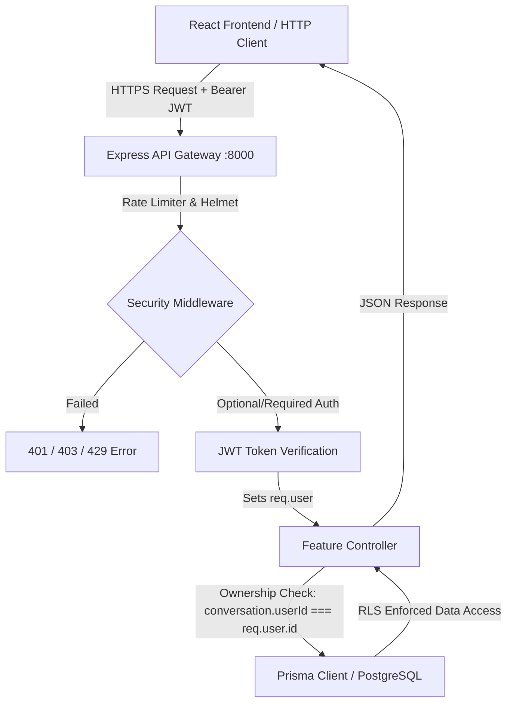

# NyayaSaathi (न्यायसाथी) — Authentication & Security Architecture

**Author:** NyayaSaathi Backend & Security Engineering  
**Version:** 1.0.0  

---

## 1. Architectural Overview

NyayaSaathi implements a **Dual-Tier Security Model**:
1. **Server-Side Gateway (Express Middleware):** Authoritative validation, JWT verification, route protection, and ownership checks.
2. **Database Row Level Security (Supabase PostgreSQL):** Direct table protection against PostgREST tampering or unauthorized data leakage.



---

## 2. Authentication Flow

### A. Citizen Registration (`POST /api/auth/register`)
- **Password Hashing:** Salted bcrypt hashing with 10 rounds (`bcrypt.hash(password, 10)`).
- **Password Constraints:** Minimum 8 characters, requiring at least one letter and one numeral.
- **Identifier Flexibility:** Citizens may register via Email address or Indian Mobile Phone number.
- **Token Generation:** On successful creation, a signed JWT is issued with `userId`, `role`, and expiration (`7d`).

### B. Citizen Login (`POST /api/auth/login`)
- Verifies credentials using constant-time comparison (`bcrypt.compare`).
- Failed authentication returns generic `401 Unauthorized` with `code: INVALID_CREDENTIALS` to prevent account enumeration.

### C. Citizen Profile (`GET /api/auth/me`)
- Requires valid `Authorization: Bearer <token>` header.
- Decoded token attaches `req.user.id` to the request object.
- Database query retrieves user fields, explicitly omitting the `password` column.

### D. Logout (`POST /api/auth/logout`)
- Acknowledges session termination.
- Because JWT is stateless, the frontend client clears `nyayasaathi_token` and `nyayasaathi_user` from `localStorage`.

---

## 3. Route Protection & Ownership Validation

| Route | Protection Level | Ownership Enforcement Rule |
| :--- | :--- | :--- |
| `POST /api/auth/register` | Public | None (Duplicate check prevents hijacking) |
| `POST /api/auth/login` | Public | Rate limited (25 req / 15 min) |
| `GET /api/auth/me` | Authenticated | Must possess valid signature; returns own user profile |
| `POST /api/chat` | Optional Auth | If conversation exists with `userId`, requestor must match `userId` or receive `403 Forbidden` |
| `GET /api/chat/conversations` | Optional Auth | Returns conversations owned by `req.user.id` |
| `GET /api/chat/conversations/:id` | Optional Auth | If conversation has `userId`, non-owners receive `403 Forbidden` |
| `PATCH /api/chat/conversations/:id`| Optional Auth | Non-owners receive `403 Forbidden` |
| `DELETE /api/chat/conversations/:id`| Optional Auth | Non-owners receive `403 Forbidden` |

---

## 4. Frontend Token Lifecycle (`frontend/src/api/client.js`)

```javascript
// Automatic token injection
apiClient.interceptors.request.use((config) => {
  const token = localStorage.getItem('nyayasaathi_token');
  if (token) {
    config.headers.Authorization = `Bearer ${token}`;
  }
  return config;
});

// Centralized error handling
apiClient.interceptors.response.use(
  (response) => response,
  (error) => {
    if (error.response?.status === 401) {
      localStorage.removeItem('nyayasaathi_token');
      localStorage.removeItem('nyayasaathi_user');
    }
    return Promise.reject(error);
  }
);
```
