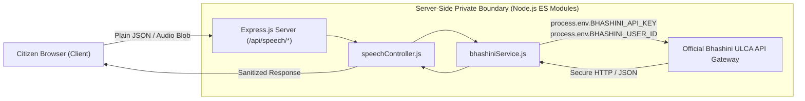

# NyayaSaathi (न्यायसाथी) Bhashini Integration & Speech API Architecture

## 1. Overview & Statutory Background

Project **Bhashini** (National Language Translation Mission, Ministry of Electronics and Information Technology - MeitY, Government of India) provides open, state-of-the-art AI models for Indian languages:
- **NMT (Neural Machine Translation)**: Bidirectional text translation across 22 Scheduled Indian languages.
- **ASR (Automated Speech Recognition)**: Indian accented speech-to-text recognition.
- **TTS (Text-to-Speech)**: High-naturalness voice synthesis for vernacular Indian audio.

NyayaSaathi integrates Bhashini as its central sovereign government translation and speech engine, adhering to strict enterprise security and zero-credential-leakage principles.

---

## 2. Security Architecture & Boundary Isolation

### Key Security Guardrails:
1. **Zero Client-Side Credentials**: `BHASHINI_API_KEY`, `BHASHINI_USER_ID`, and pipeline endpoints are never bundled into the Vite/React frontend or exposed via public environment variables (`VITE_*`).
2. **Input Sanitization & Normalization**: Text length limits, MIME-type checks on base64 audio, and language code validation prior to dispatching upstream requests.
3. **Resilient Local Fallback**: When external network calls fail or credentials are unconfigured, server returns structured fallback payloads (`provider: 'fallback'`) without crashing.

---

## 3. Server-Side Service Implementation (`backend/src/services/bhashiniService.js`)

### 3.1 Language Code Normalization
Incoming BCP-47 language tags are normalized to ISO-639-1 two-letter codes:
- `hi-IN` $\rightarrow$ `hi`
- `mr-IN` $\rightarrow$ `mr`
- `en-IN` $\rightarrow$ `en`
- `ta-IN` $\rightarrow$ `ta`

### 3.2 Resilience, Timeouts & Exponential Backoff
- **Timeout**: 6,000ms per HTTP call.
- **Retries**: Up to 2 retries with exponential backoff (`delay = 200ms * (attempt + 1)`).
- **Identity Optimization**: When `sourceLanguage === targetLanguage`, the engine returns the original text instantly with `provider: 'identity'`, saving 100% of network latency and API quota.

### 3.3 Error Taxonomy & Error Classification
Upstream errors are mapped to domain-specific error types:
- `TIMEOUT_ERROR`: Upstream gateway took longer than 6000ms.
- `NETWORK_ERROR`: Connection refused or DNS failure.
- `AUTHENTICATION_ERROR`: Invalid or expired API credentials (HTTP 401/403).
- `VALIDATION_ERROR`: Invalid language pair or unprocessable payload.
- `UPSTREAM_SERVICE_ERROR`: 5xx errors from Bhashini ULCA pipeline.

---

## 4. Speech REST Endpoints (`backend/src/routes/speech.js`)

| Endpoint | Method | Payload | Response | Description |
|---|---|---|---|---|
| `/api/speech/languages` | `GET` | *None* | `{ success: true, languages: [...], ttsVoices: [...] }` | Returns supported Indian language codes, names, and speech capability matrices. |
| `/api/speech/translate` | `POST` | `{ text, sourceLang, targetLang }` | `{ success: true, text: string, provider: string, translated: boolean }` | Translates text between Indian languages. |
| `/api/speech/asr` | `POST` | `{ audioContent, language }` | `{ success: true, transcript: string, confidence: number, provider: string }` | Converts base64 encoded audio bytes into text. |
| `/api/speech/tts` | `POST` | `{ text, language, gender }` | `{ success: true, audioContent: string, audioFormat: 'wav', provider: string }` | Synthesizes vernacular speech audio from legal text. |

---

## 5. Frontend Voice & Speech Synthesis Flow

### 5.1 Voice Question Input (Speech-to-Text)
Integrated into `frontend/src/pages/Chat.jsx`:
- Checks for browser `window.SpeechRecognition` or `window.webkitSpeechRecognition`.
- Automatically maps selected UI language to speech locale tag:
  - English $\rightarrow$ `en-IN`
  - Hindi $\rightarrow$ `hi-IN`
  - Marathi $\rightarrow$ `mr-IN`
- Provides real-time visual feedback: animated listening wave, pulsing microphone icon, and accessible status announcements via `aria-live="polite"`.

### 5.2 Read Aloud (Text-to-Speech)
- Playback controls attached to assistant chat responses and statutory legal summaries:
  - **Play**: Initiates speech synthesis in the active language.
  - **Pause**: Pauses active utterance.
  - **Stop**: Immediately cancels speech queue and releases audio handles.
- **Client Speech Synthesis Fallback**: Employs client-side `window.speechSynthesis` for instant zero-latency speech output in `hi-IN`, `mr-IN`, and `en-IN` when operating in offline environments.
- **Strict User Consent**: Speech is **never** played automatically upon page load or response generation; an explicit user click on the Read Aloud icon is mandatory.
