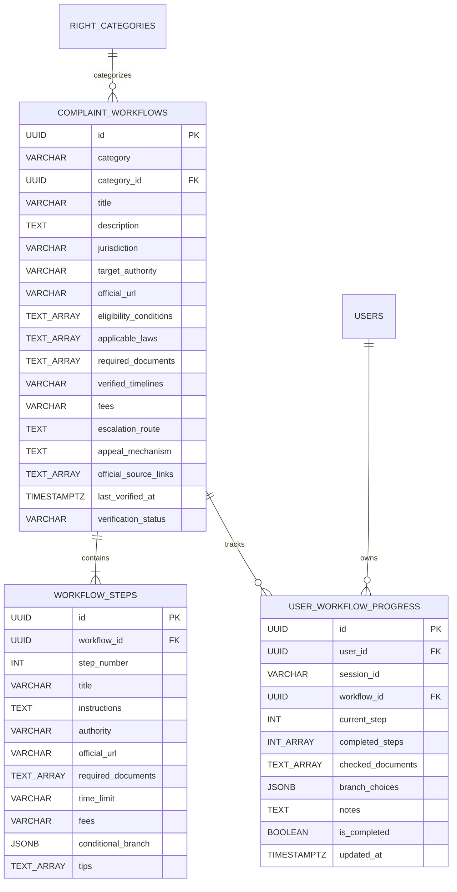

# NyayaSaathi (न्यायसाथी) — Complaint Workflow Data Model

## 1. Relational Schema Architecture

The Legal Action Navigator schema is owned by PostgreSQL in Supabase and managed via Prisma ORM:



---

## 2. Table Specifications

### 2.1 `public.complaint_workflows`
Stores high-level procedure definitions, jurisdiction applicability, and statutory governance.

| Column | Type | Constraints | Description |
|---|---|---|---|
| `id` | `UUID` | `PRIMARY KEY`, Default `gen_random_uuid()` | Unique workflow identifier |
| `category` | `VARCHAR(100)` | Not Null | Legacy category string (e.g. `LABOUR`, `DOMESTIC_VIOLENCE`) |
| `category_id` | `UUID` | `REFERENCES right_categories(id)` | Foreign key to standard rights category |
| `title` | `VARCHAR(255)` | Not Null | Official procedure title |
| `description` | `TEXT` | Nullable | Procedural summary & citizen context |
| `jurisdiction` | `VARCHAR(50)` | Default `'BOTH'` | `'CENTRAL'`, `'STATE'`, or `'BOTH'` |
| `target_authority`| `VARCHAR(255)` | Nullable | Primary statutory body handling the claim |
| `official_url` | `VARCHAR(500)` | Nullable | Primary government filing portal |
| `eligibility_conditions` | `TEXT[]` | Default `ARRAY[]::TEXT[]` | Prerequisite eligibility requirements |
| `applicable_laws` | `TEXT[]` | Default `ARRAY[]::TEXT[]` | Relevant statutes & sections |
| `required_documents` | `TEXT[]` | Default `ARRAY[]::TEXT[]` | Master pre-requisite document list |
| `verified_timelines` | `VARCHAR(255)` | Nullable | Statutory timelines & limitation periods |
| `fees` | `VARCHAR(255)` | Nullable | Prescribed court/filing fee or waiver criteria |
| `escalation_route` | `TEXT` | Nullable | Sequential hierarchy of authorities |
| `appeal_mechanism` | `TEXT` | Nullable | Appellate court, limitation period, and forum |
| `official_source_links` | `TEXT[]` | Default `ARRAY[]::TEXT[]` | Traceable official government references |
| `last_verified_at` | `TIMESTAMPTZ` | Default `NOW()` | Timestamp of last legal review |
| `verification_status` | `VARCHAR(50)` | Default `'VERIFIED'` | Verification status (`VERIFIED`, `PENDING_REVIEW`) |

---

### 2.2 `public.workflow_steps`
Stores individual sequential steps belonging to a workflow.

| Column | Type | Constraints | Description |
|---|---|---|---|
| `id` | `UUID` | `PRIMARY KEY`, Default `gen_random_uuid()` | Unique step identifier |
| `workflow_id` | `UUID` | `REFERENCES complaint_workflows(id) ON DELETE CASCADE` | Parent workflow reference |
| `step_number` | `INT` | Not Null | 1-indexed sequential step order |
| `title` | `VARCHAR(255)` | Not Null | Step objective |
| `instructions` | `TEXT` | Nullable | Clear procedural guidance |
| `authority` | `VARCHAR(255)` | Nullable | Competent office for this step |
| `official_url` | `VARCHAR(500)` | Nullable | Specific portal or form link |
| `required_documents` | `TEXT[]` | Default `ARRAY[]::TEXT[]` | Documents needed specifically for this step |
| `time_limit` | `VARCHAR(100)` | Nullable | Statutory deadline for this step |
| `fees` | `VARCHAR(100)` | Nullable | Step-specific fees (or 'Free') |
| `conditional_branch` | `JSONB` | Nullable | Decision question and branch actions |
| `tips` | `TEXT[]` | Default `ARRAY[]::TEXT[]` | Practical hints & legal safeguards |

#### Conditional Branching Schema (`conditional_branch` JSONB)
```json
{
  "question": "Did your employer clear the wages or respond within 14 days?",
  "options": [
    {
      "label": "Yes, full settlement received",
      "nextAction": "Close dispute and request written settlement voucher."
    },
    {
      "label": "Partial or no payment received",
      "nextAction": "Proceed to Step 3: File grievance on Shram Suvidha portal."
    }
  ]
}
```

---

### 2.3 `public.user_workflow_progress`
Stores personal, private progress for authenticated users and anonymous sessions.

| Column | Type | Constraints | Description |
|---|---|---|---|
| `id` | `UUID` | `PRIMARY KEY`, Default `gen_random_uuid()` | Unique progress identifier |
| `user_id` | `UUID` | `REFERENCES users(id) ON DELETE CASCADE` | Optional authenticated user ID |
| `session_id` | `VARCHAR(255)` | Nullable | Guest session ID for unauthenticated users |
| `workflow_id` | `UUID` | `REFERENCES complaint_workflows(id) ON DELETE CASCADE` | Workflow being tracked |
| `current_step` | `INT` | Default `1` | Active step number |
| `completed_steps` | `INT[]` | Default `ARRAY[]::INT[]` | Array of completed step numbers |
| `checked_documents`| `TEXT[]` | Default `ARRAY[]::TEXT[]` | List of confirmed prepared documents |
| `branch_choices` | `JSONB` | Default `'{}'::JSONB` | Recorded decision choices per step |
| `notes` | `TEXT` | Nullable | User private notes & case details |
| `is_completed` | `BOOLEAN` | Default `FALSE` | All steps finalized flag |
| `created_at` | `TIMESTAMPTZ`| Default `NOW()` | Record creation timestamp |
| `updated_at` | `TIMESTAMPTZ`| Default `NOW()` | Last progress update timestamp |
