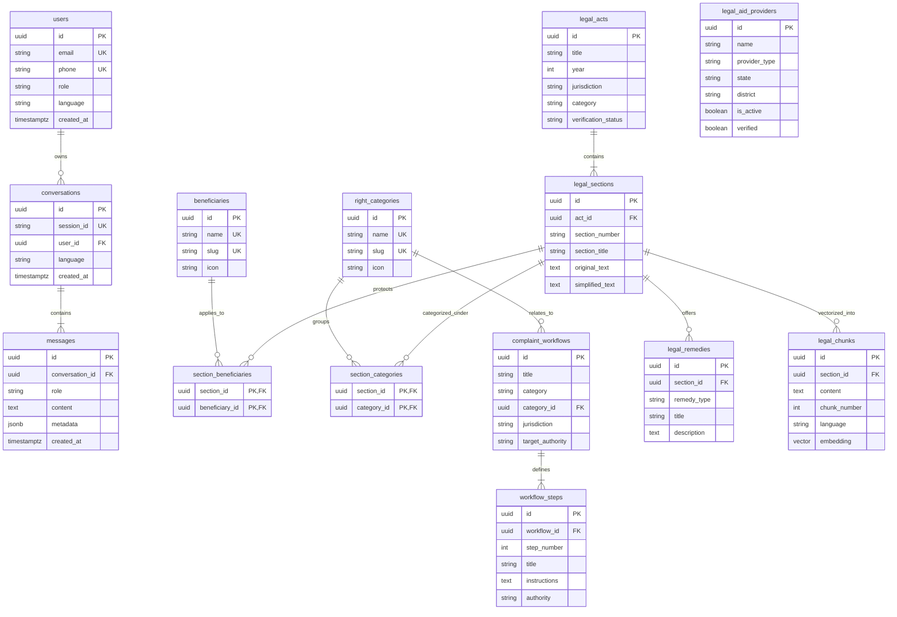

# Entity Relationship Model — NyayaSaathi (न्यायसाथी)

This document visualizes the complete relational data model of NyayaSaathi across all 14 tables.

---

## 1. Complete Entity-Relationship Diagram (ERD)

---

## 2. Relationship Cardinality Matrix

| Source Entity | Foreign Key Column | Target Entity | Referenced Column | Cardinality | `ON DELETE` Action | Business Description |
| :--- | :--- | :--- | :--- | :--- | :--- | :--- |
| `conversations` | `user_id` | `users` | `id` | Many-to-One (0..* : 1) | `SET NULL` | A user can own multiple chat sessions. Guest sessions have `user_id = NULL`. |
| `messages` | `conversation_id` | `conversations` | `id` | Many-to-One (1..* : 1) | `CASCADE` | Dialogue messages belong to one conversation; deleting a conversation cleans up all messages. |
| `legal_sections` | `act_id` | `legal_acts` | `id` | Many-to-One (1..* : 1) | `CASCADE` | Sections belong to one Act; deleting an Act cascades to its sections. |
| `section_beneficiaries`| `section_id` | `legal_sections` | `id` | Many-to-One | `CASCADE` | Junction table associating sections with target beneficiary groups. |
| `section_beneficiaries`| `beneficiary_id`| `beneficiaries` | `id` | Many-to-One | `CASCADE` | Junction table associating sections with target beneficiary groups. |
| `section_categories` | `section_id` | `legal_sections` | `id` | Many-to-One | `CASCADE` | Junction table associating sections with broad right categories. |
| `section_categories` | `category_id` | `right_categories`| `id` | Many-to-One | `CASCADE` | Junction table associating sections with broad right categories. |
| `complaint_workflows` | `category_id` | `right_categories`| `id` | Many-to-One (0..* : 1) | `SET NULL` | Workflows relate to a right category; removing a category does not delete the procedure. |
| `workflow_steps` | `workflow_id` | `complaint_workflows` | `id` | Many-to-One (1..* : 1) | `CASCADE` | Steps belong to a workflow; removing a workflow purges its step sequence. |
| `legal_remedies` | `section_id` | `legal_sections` | `id` | Many-to-One (0..* : 1) | `CASCADE` | Specific remedies (e.g. damages, complaint) associated with a statutory section. |
| `legal_chunks` | `section_id` | `legal_sections` | `id` | Many-to-One (0..* : 1) | `CASCADE` | AI vector chunk passages tied to a statutory section for grounded retrieval. |

---

## 3. Key Normalization Guarantees

1. **Third Normal Form (3NF)**:
   - All transitive dependencies removed. Junction tables `section_beneficiaries` and `section_categories` handle Many-to-Many relationships cleanly.
   - Text descriptions are separated from junction relationships.
2. **Statutory Truth vs. AI Grounding Separation**:
   - `legal_sections` holds the authoritative statutory provisions (`original_text` verbatim from Indian statutes, alongside plain-language `simplified_text`).
   - `legal_chunks` stores the sliced and embedded vectors strictly for semantic search indexing. The AI engine never mutates `legal_sections`.
3. **Session Ownership & Authentication Lifecycle**:
   - Conversations are referenced by a durable `session_id` string for anonymous guest users.
   - Upon authentication, `userId` is updated without breaking existing message history or forcing a schema reset.
