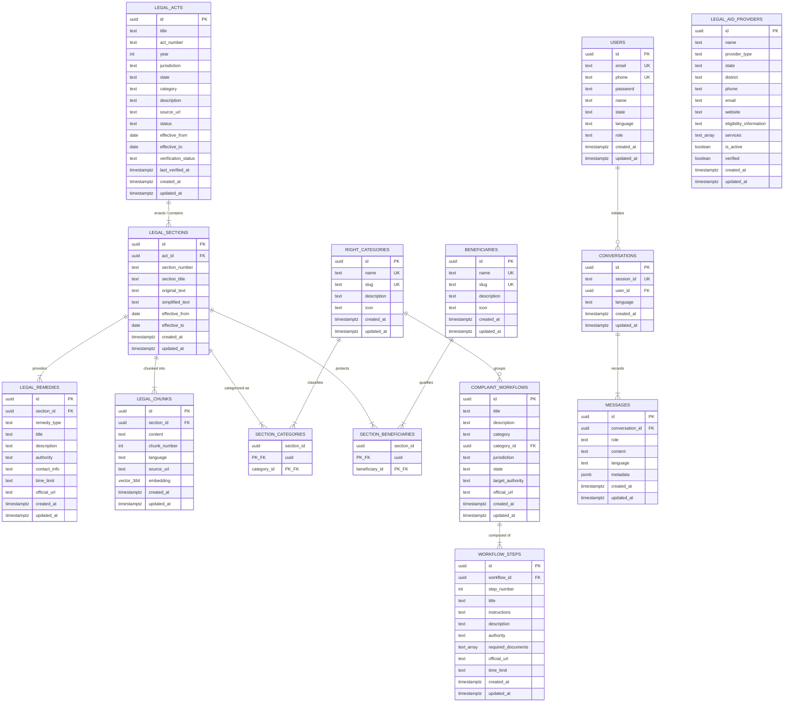
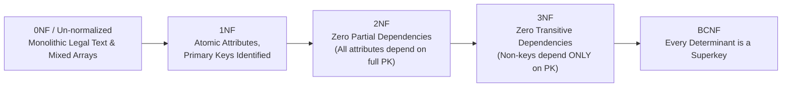

# NyayaSaathi (न्यायसाथी) — Entity-Relationship (ER) Model & Database Normalization

This document provides the formal architectural specification of the **NyayaSaathi** relational and vector database schema. It includes:
1. **System Overview & Domain Boundary**
2. **Mermaid Entity-Relationship (ER) Diagram**
3. **Entity & Attribute Dictionary**
4. **Relationship Cardinalities & Integrity Constraints**
5. **Formal Normalization Process (1NF → 2NF → 3NF → BCNF)**
6. **Denormalization & Vector-Storage Trade-off Analysis**

---

## 1. Domain Overview & Architectural Separation

In legal domain modeling, a common pitfall is conflating **authentic legislative enactments** (Gazette Acts, statutory sections) with **citizen-facing derivative representations** (simplified summaries, grievance workflows, vector chunks). 

NyayaSaathi solves this by cleanly isolating the database into four decoupled functional clusters:
- **Cluster 1: Statutory Knowledge Graph** (`legal_acts`, `legal_sections`, `beneficiaries`, `right_categories`, `section_beneficiaries`, `section_categories`)
- **Cluster 2: Administrative Grievance & Legal Aid** (`complaint_workflows`, `workflow_steps`, `legal_aid_providers`, `legal_remedies`)
- **Cluster 3: Multilingual Semantic Search & RAG** (`legal_chunks` with `pgvector` HNSW indexing)
- **Cluster 4: Application Session Persistence** (`users`, `conversations`, `messages`)

---

## 2. Mermaid Entity-Relationship (ER) Diagram

---

## 3. Entity & Attribute Dictionary

### 3.1 Statutory Entities
- **`legal_acts`**: Represents an authentic enactment passed by Parliament or a State Legislative Assembly (e.g., *Payment of Wages Act, 1936*).
  - Primary Key: `id` (UUID)
  - Alternate Keys: `(title, year, jurisdiction)`
- **`legal_sections`**: An atomic statutory clause within an Act (e.g., *Section 5 — Time of payment of wages*).
  - Primary Key: `id` (UUID)
  - Business Candidate Key: `(act_id, section_number)`
  - Foreign Key: `act_id` $\to$ `legal_acts(id)` ON DELETE CASCADE
- **`right_categories`**: Functional taxonomy classifications (e.g., *Labour Rights*, *Women Rights*).
  - Candidate Keys: `id` (UUID), `name` (TEXT), `slug` (TEXT)
- **`beneficiaries`**: Protected demographic classes under affirmative legislation (e.g., *Workers*, *Women*, *SC/ST*).
  - Candidate Keys: `id` (UUID), `name` (TEXT), `slug` (TEXT)

### 3.2 Junction (Bridge) Entities
- **`section_categories`**: Many-to-Many bridge associating a statutory section with multiple legal categories.
  - Primary Key: `(section_id, category_id)`
  - Foreign Keys: `section_id` $\to$ `legal_sections(id)`, `category_id` $\to$ `right_categories(id)`
- **`section_beneficiaries`**: Many-to-Many bridge mapping legal provisions to protected citizen groups.
  - Primary Key: `(section_id, beneficiary_id)`
  - Foreign Keys: `section_id` $\to$ `legal_sections(id)`, `beneficiary_id` $\to$ `beneficiaries(id)`

### 3.3 Remedies & Workflows
- **`legal_remedies`**: Direct actions available under a provision (e.g., Application to Labour Commissioner, Magistrate DIR petition).
  - Foreign Key: `section_id` $\to$ `legal_sections(id)` ON DELETE CASCADE
- **`complaint_workflows`**: Step-by-step citizen guide for administrative or quasi-judicial dispute resolution.
  - Foreign Key: `category_id` $\to$ `right_categories(id)` ON DELETE SET NULL
- **`workflow_steps`**: Sequential checklist tasks (e.g., Step 1: Collect bank statements; Step 2: Serve demand notice).
  - Alternate Candidate Key: `(workflow_id, step_number)`
  - Foreign Key: `workflow_id` $\to$ `complaint_workflows(id)` ON DELETE CASCADE
- **`legal_aid_providers`**: Directory of statutory legal services clinics (NALSA, SLSA, DLSA, Taluka clinics). Standalone entity with geographical and eligibility filters.

### 3.4 AI Vector Knowledge Base
- **`legal_chunks`**: Paragraph-sized text segments of legal sections paired with high-dimensional embeddings (`vector(384)`) for semantic cosine similarity search.
  - Candidate Key: `(section_id, chunk_number, language)`
  - Foreign Key: `section_id` $\to$ `legal_sections(id)` ON DELETE CASCADE

### 3.5 Citizen Session & Chat Persistence
- **`users`**: Registered citizens, paralegals, or administrators.
  - Candidate Keys: `id`, `email`, `phone`
- **`conversations`**: Dialogue session container.
  - Candidate Keys: `id`, `session_id`
  - Foreign Key: `user_id` $\to$ `users(id)` ON DELETE SET NULL (supports guest users)
- **`messages`**: Individual question/answer exchanges with grounding metadata.
  - Foreign Key: `conversation_id` $\to$ `conversations(id)` ON DELETE CASCADE

---

## 4. Formal Normalization Analysis

To verify structural integrity and prevent anomalies (insert, update, delete), the schema is evaluated systematically from 1NF through BCNF.

---

### Step 1: First Normal Form (1NF)

**Definition:** A relation is in 1NF if and only if:
1. Every attribute domain contains only atomic (indivisible) values.
2. There are no repeating groups or composite columns.
3. Each record is uniquely identified by a primary key.

#### Violations in 0NF (Un-normalized form)
In legacy legal document management, schemas often look like:
$$\text{LEGAL\_PROVISION}(\underline{\text{ActSection}}, \text{ActTitle}, \text{Categories}, \text{Beneficiaries}, \text{RemedyList}, \text{Steps})$$
Where `Categories` = `"Labour, Wages, Factory"` (comma-separated string), and `RemedyList` is a nested array.

#### Transformation to 1NF
1. Split multi-valued categories and beneficiaries out into atomic relational rows.
2. Junction tables `section_categories` and `section_beneficiaries` store single atomic foreign key pairs:
   $$\text{section\_categories}(\underline{\text{section\_id}, \text{category\_id}})$$
   $$\text{section\_beneficiaries}(\underline{\text{section\_id}, \text{beneficiary\_id}})$$
3. Every table is assigned an unambiguous primary key (`id UUID PRIMARY KEY DEFAULT gen_random_uuid()` or composite PK).

**Status:** ✅ **1NF Satisfied across all 14 tables.**

---

### Step 2: Second Normal Form (2NF)

**Definition:** A relation is in 2NF if:
1. It is in 1NF.
2. No non-prime attribute is partially dependent on any candidate key (no partial functional dependency: $X \subset K \implies X \not\to A$ for any non-prime $A$).

#### Analysis of Composite Key Tables
The only tables with composite candidate keys are:
1. **`section_categories`**:
   - Primary Key: `(section_id, category_id)`
   - Non-prime attributes: None.
   - Conclusion: Trivially in 2NF.
2. **`section_beneficiaries`**:
   - Primary Key: `(section_id, beneficiary_id)`
   - Non-prime attributes: None.
   - Conclusion: Trivially in 2NF.
3. **`workflow_steps`**:
   - Composite Candidate Key: `(workflow_id, step_number)`
   - Surrogate Key: `id`
   - Functional Dependencies:
     $$\{\text{id}\} \to \{\text{workflow\_id}, \text{step\_number}, \text{title}, \text{instructions}, \text{authority}, \dots\}$$
     $$\{\text{workflow\_id}, \text{step\_number}\} \to \{\text{id}, \text{title}, \text{instructions}, \text{authority}, \dots\}$$
   - All non-prime attributes describe the *specific step* within that workflow. Neither `workflow_id` alone nor `step_number` alone determines `title` or `instructions`.
4. **`legal_sections`**:
   - Composite Candidate Key: `(act_id, section_number)`
   - Surrogate Key: `id`
   - Functional Dependency:
     $$\{\text{act\_id}, \text{section\_number}\} \to \{\text{original\_text}, \text{simplified\_text}, \text{section\_title}\}$$
   - Neither `act_id` alone (one Act has many sections) nor `section_number` alone ("Section 5" appears in hundreds of different Indian Acts) determines the statutory clause.

**Status:** ✅ **2NF Satisfied. Zero partial dependencies exist.**

---

### Step 3: Third Normal Form (3NF)

**Definition:** A relation is in 3NF if:
1. It is in 2NF.
2. No non-prime attribute is transitively dependent on the primary key ($X \to Y$ and $Y \to Z$ where $Z$ is non-prime is forbidden).

#### Examination of Dependencies
- **`legal_sections`**:
  - Primary Key: `id`
  - $FD_1: \text{id} \to \{\text{act\_id}, \text{section\_number}, \text{original\_text}, \text{simplified\_text}\}$
  - Does $\text{act\_id} \to \text{act\_title}$ exist inside `legal_sections`? **No.** `act_title`, `year`, and `jurisdiction` live strictly in `legal_acts`.
  - Therefore, there is no transitive dependency $\text{id} \to \text{act\_id} \to \text{act\_title}$.
- **`complaint_workflows`**:
  - Primary Key: `id`
  - Category metadata (`description`, `icon`) is not duplicated in `complaint_workflows`; it is referenced via $\text{category\_id} \to \text{right\_categories(id)}$.
- **`conversations` & `messages`**:
  - Primary Key of `messages`: `id`
  - $FD: \text{id} \to \{\text{conversation\_id}, \text{content}, \text{role}\}$
  - `user_id`, `email`, and `user_role` are stored only in `conversations` $\to$ `users`, avoiding $\text{message\_id} \to \text{conversation\_id} \to \text{user\_email}$.
- **`legal_chunks`**:
  - Primary Key: `id`
  - $FD: \text{id} \to \{\text{section\_id}, \text{chunk\_number}, \text{content}, \text{embedding}\}$
  - Act information is retrieved by joining through $\text{legal\_sections} \to \text{legal\_acts}$, not hardcoded into chunk records.

**Status:** ✅ **3NF Satisfied. Zero transitive dependencies exist.**

---

### Step 4: Boyce-Codd Normal Form (BCNF)

**Definition:** A relation is in BCNF if for every non-trivial functional dependency $X \to Y$, $X$ is a **superkey**.

Let us examine all candidate keys across each entity:

| Entity | Candidate Keys | Functional Dependencies ($X \to Y$) | Determinant $X$ is Superkey? |
|---|---|---|:---:|
| `legal_acts` | `id` | $\text{id} \to \text{all attributes}$ | ✅ Yes |
| `legal_sections` | $K_1 = \{\text{id}\}$, $K_2 = \{\text{act\_id}, \text{section\_number}\}$ | Both $K_1$ and $K_2$ determine all other attributes | ✅ Yes |
| `right_categories` | $K_1 = \{\text{id}\}$, $K_2 = \{\text{name}\}$, $K_3 = \{\text{slug}\}$ | All three candidate keys uniquely determine description and icon | ✅ Yes |
| `beneficiaries` | $K_1 = \{\text{id}\}$, $K_2 = \{\text{name}\}$, $K_3 = \{\text{slug}\}$ | All three candidate keys uniquely determine description and icon | ✅ Yes |
| `section_categories`| $K = \{\text{section\_id}, \text{category\_id}\}$ | No non-trivial dependencies beyond candidate key | ✅ Yes |
| `section_beneficiaries`| $K = \{\text{section\_id}, \text{beneficiary\_id}\}$ | No non-trivial dependencies beyond candidate key | ✅ Yes |
| `complaint_workflows`| `id` | $\text{id} \to \text{all attributes}$ | ✅ Yes |
| `workflow_steps` | $K_1 = \{\text{id}\}$, $K_2 = \{\text{workflow\_id}, \text{step\_number}\}$ | Both determine step title, instructions, and authority | ✅ Yes |
| `legal_aid_providers`| `id` | $\text{id} \to \text{all attributes}$ | ✅ Yes |
| `legal_remedies` | `id` | $\text{id} \to \text{all attributes}$ | ✅ Yes |
| `legal_chunks` | $K_1 = \{\text{id}\}$, $K_2 = \{\text{section\_id}, \text{chunk\_number}, \text{language}\}$ | Both determine content, source URL, and embedding | ✅ Yes |
| `users` | $K_1 = \{\text{id}\}$, $K_2 = \{\text{email}\}$, $K_3 = \{\text{phone}\}$ | Any candidate key uniquely identifies user state | ✅ Yes |
| `conversations` | $K_1 = \{\text{id}\}$, $K_2 = \{\text{session\_id}\}$ | Both candidate keys determine user, language, and timestamps | ✅ Yes |
| `messages` | `id` | $\text{id} \to \{\text{conversation\_id}, \text{role}, \text{content}, \text{metadata}\}$ | ✅ Yes |

**Conclusion:** Because every determinant in every functional dependency is a superkey, the entire schema is in **Boyce-Codd Normal Form (BCNF)**.

---

## 5. Architectural Trade-offs & Controlled Denormalization

While the relational model strictly satisfies 3NF/BCNF, specific optimizations were introduced for performance and vector operations:

> [!NOTE]
> ### 1. Postgres Native Arrays (`TEXT[]`) in `workflow_steps` & `legal_aid_providers`
> In strict relational theory, `required_documents` could be split into a separate table `step_documents(step_id, document_name)`.  
> **Engineering Decision**: Postgres `TEXT[]` was chosen because checklist documents and service tags are small, atomic lists ($< 6$ items) that are always fetched, displayed, and updated together with the parent step. Avoiding an extra join table saves I/O and query latency without introducing update anomalies.

> [!TIP]
> ### 2. Decoupling Vector Chunks (`legal_chunks`) from Statutory Sections (`legal_sections`)
> Embedding models evolve (e.g., changing from `MiniLM` 384-dim to `BGE-m3` 1024-dim, or chunking by paragraph vs. sub-clause).  
> **Engineering Decision**: Isolating embeddings in `legal_chunks` guarantees that re-indexing, re-chunking, or deleting vector representations never mutates authentic legislative texts (`legal_sections`).

> [!IMPORTANT]
> ### 3. Denormalized Slug Field on Categories and Beneficiaries
> Both `name` and `slug` have unique indexes. The human-readable URL slug (e.g., `/rights/labour`, `/rights/women`) allows direct $O(1)$ indexed routing on the frontend and backend without requiring sequential table scans or ID lookups.

---

## 6. Summary of Constraints & Cascade Rules

| Relationship | Constraint Rule | Justification |
|---|---|---|
| `legal_sections.act_id \to legal_acts.id` | **ON DELETE CASCADE** | If a statute is revoked/removed, its clauses cannot exist independently. |
| `section_categories.section_id \to legal_sections.id` | **ON DELETE CASCADE** | Removing a section removes its category assignments. |
| `section_beneficiaries.section_id \to legal_sections.id`| **ON DELETE CASCADE** | Removing a section removes its beneficiary assignments. |
| `workflow_steps.workflow_id \to complaint_workflows.id`| **ON DELETE CASCADE** | Steps have no meaning without their parent workflow. |
| `legal_chunks.section_id \to legal_sections.id` | **ON DELETE CASCADE** | Orphan embeddings must never be returned in vector search. |
| `conversations.user_id \to users.id` | **ON DELETE SET NULL** | If a user deletes their account, legal audit logs and chat sessions are preserved anonymously. |
| `messages.conversation_id \to conversations.id` | **ON DELETE CASCADE** | Deleting a chat conversation clears all associated dialogue turns. |
| `complaint_workflows.category_id \to right_categories.id`| **ON DELETE SET NULL** | Workflows remain accessible even if a high-level category is reorganized. |
