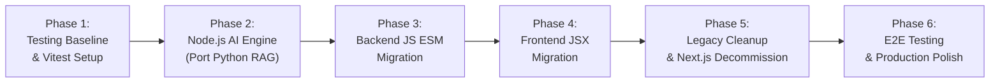

# NyayaSaathi (न्यायसाथी) — Phased Implementation Roadmap

**Objective:** Incremental migration from dual-stack (TypeScript + Python) to a unified **100% JavaScript (ES Modules)** architecture without downtime or feature regression.

---

## 1. Roadmap Overview & Timeline



---

## 2. Phase-by-Phase Execution Plan

### Phase 1: Testing Infrastructure Baseline
**Goal:** Establish an automated safety net before refactoring application code.
- **Tasks:**
  1. Install `vitest` and `@vitest/coverage-v8` in backend and frontend.
  2. Install `supertest` for Express endpoint contract testing.
  3. Write baseline integration tests for existing working endpoints:
     - `GET /health` and `GET /api/health`
     - `GET /api/rights` and `GET /api/rights/labour`
     - `GET /api/aid`
     - `POST /api/eligibility`
     - `POST /api/chat`
  4. Ensure all tests run and pass via `npm test`.
- **Exit Criteria:** Green test suite verifying all 5 core routes.

---

### Phase 2: Node.js AI Service (Port Python RAG to JavaScript)
**Goal:** Replicate all Python FastAPI RAG and embedding functionality directly in Node.js.
- **Tasks:**
  1. Install official Google Gemini JavaScript SDK:
     ```bash
     npm install @google/genai --workspace=backend
     ```
  2. Implement `backend/src/ai/intentClassifier.js`:
     - Port the intent classification logic for `LABOUR`, `WOMEN_RIGHTS`, `CONSUMER`, `CRIMINAL`, `PROPERTY`, `CONSTITUTIONAL`.
  3. Implement `backend/src/ai/ragPipeline.js`:
     - Connect query embeddings directly via JavaScript.
     - Call Supabase stored procedure `match_legal_chunks` through `@supabase/supabase-js`.
  4. Implement `backend/src/ai/promptTemplates.js`:
     - Port multilingual prompt construction, statutory citation injection, and NALSA helpline formatting.
  5. Connect `backend/src/controllers/chatController.js` to the new in-process Node.js RAG service.
  6. Verify end-to-end chat queries return grounded citations directly from Node.js.
- **Exit Criteria:** `POST /api/chat` returns grounded citations from Supabase without calling port 8001.

---

### Phase 3: Backend TypeScript to JavaScript ES Modules Migration
**Goal:** Convert the backend from TypeScript to native Node.js ES Modules.
- **Tasks:**
  1. Set `"type": "module"` in `backend/package.json`.
  2. Configure Prisma Client generation for JavaScript:
     ```prisma
     generator client {
       provider = "prisma-client-js"
     }
     ```
  3. Incrementally rename `backend/src/**/*.ts` to `.js`:
     - `src/lib/prisma.ts` $\to$ `src/lib/prisma.js`
     - `src/services/*.ts` $\to$ `src/services/*.js`
     - `src/controllers/*.ts` $\to$ `src/controllers/*.js`
     - `src/routes/*.ts` $\to$ `src/routes/*.js`
     - `src/app.ts` $\to$ `src/app.js`
     - `src/index.ts` $\to$ `src/index.js`
  4. Update imports to include `.js` file extensions per ES Module specifications.
  5. Replace `ts-node-dev` with Node's native watch mode (`node --watch src/index.js`).
  6. Run Vitest & Supertest suite to confirm zero regressions.
- **Exit Criteria:** Backend runs natively with `node src/index.js` without any TypeScript build step.

---

### Phase 4: Frontend TypeScript to React JSX Migration
**Goal:** Transition the frontend from TypeScript (`.tsx`) to pure React JavaScript (`.jsx`).
- **Tasks:**
  1. Rename files from `.tsx` / `.ts` to `.jsx` / `.js`:
     - `src/main.tsx` $\to$ `src/main.jsx`
     - `src/App.tsx` $\to$ `src/App.jsx`
     - `src/pages/*.tsx` $\to$ `src/pages/*.jsx`
     - `src/components/**/*.tsx` $\to$ `src/components/**/*.jsx`
     - `src/hooks/*.ts` $\to$ `src/hooks/*.js`
     - `src/api/*.ts` $\to$ `src/api/*.js`
  2. Update `frontend/vite.config.js` to remove TypeScript-specific plugins.
  3. Verify Vite bundle build passes cleanly: `npm run build --workspace=frontend`.
- **Exit Criteria:** Vite builds production bundle in $<1.5$ seconds with zero TypeScript dependencies.

---

### Phase 5: Legacy Cleanup & Decommissioning
**Goal:** Remove legacy Python and Next.js artifacts cleanly from the repository.
- **Tasks:**
  1. Safely remove alien Next.js files (`page.tsx`, `utils/supabase/`).
  2. Archive and remove `ai-engine/` directory and Python virtualenv.
  3. Clean up `package.json` scripts: simplify `dev` to run frontend and backend only.
  4. Update root `.gitignore` to reflect the pure JavaScript stack.
- **Exit Criteria:** Repository contains only pure JavaScript, JSX, SQL, Docker, and Markdown files.

---

### Phase 6: Automated End-to-End Testing & CI/CD
**Goal:** Ensure long-term reliability and automated verification on every PR.
- **Tasks:**
  1. Configure **Playwright** for browser testing:
     - Test language switching (English $\leftrightarrow$ Hindi).
     - Test Rights catalog navigation.
     - Test Eligibility calculator flow.
     - Test AI Chat submission and response streaming.
  2. Create `.github/workflows/ci.yml`:
     - Step 1: `npm ci`
     - Step 2: `npm run lint`
     - Step 3: `npm run test` (Vitest & Supertest)
     - Step 4: `npm run build`
     - Step 5: `npx playwright test`
- **Exit Criteria:** Automated GitHub Actions pipeline runs all tests on every push.
