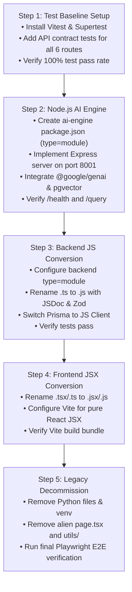

# NyayaSaathi (न्यायसाथी) — Controlled JavaScript Migration Plan

**Document:** `docs/JAVASCRIPT_MIGRATION_PLAN.md`  
**Standard:** 100% JavaScript (ES Modules, JSX, JSDoc, Node.js 20+ LTS)  
**Status:** Architectural Specification & Pre-Migration Audit

---

## 1. Executive Migration Strategy

NyayaSaathi is transitioning from a heterogeneous multi-language codebase (TypeScript, Python 3.14, and accidental Next.js fragments) to a unified, performant, and developer-friendly **JavaScript-first architecture**.

### Core Tenets:
1. **Zero Destructive Rewrites**: Migration occurs file-by-file with regression verification at each step.
2. **Preserve Database & Public API Contracts**: Existing Supabase PostgreSQL tables, migrations, pgvector stored procedures (`match_legal_chunks`), and frontend REST endpoints (`/api/*`) remain 100% backward-compatible.
3. **Node.js Express AI Engine**: The Python FastAPI service (`ai-engine/`) is converted into an independent **Node.js Express microservice** (`ai-engine/`) within the npm workspace.
4. **JSDoc & Runtime Schema Validation**: Static TypeScript interfaces are replaced by expressive **JSDoc type annotations** combined with **Zod schema validation** for untrusted network boundaries.
5. **Testing First**: Establish a robust Vitest and Supertest testing harness before altering application code.

---

## 2. Dependency Compatibility & Ecosystem Analysis

### 2.1 Runtime & Module System
- **Node.js Version**: `>=20.0.0` (LTS).
- **Module Format**: ECMAScript Modules (`"type": "module"` in `backend/package.json` and `ai-engine/package.json`).
- **Imports**: All internal relative imports must explicitly include file extensions (e.g., `import { prisma } from './lib/prisma.js'`).

### 2.2 Package Ecosystem Audit
| Purpose | Current Package | Target JavaScript Package | Compatibility Status |
| :--- | :--- | :--- | :--- |
| **ORM** | `@prisma/client` (v5.22.0) | `@prisma/client` (JavaScript generator) | **100% Native**: Prisma natively generates JS clients |
| **Database Client** | `@supabase/supabase-js` | `@supabase/supabase-js` (v2.x) | **100% Native**: Pure JS ES Module support |
| **LLM SDK** | LangChain / Direct Axios | `@google/genai` (Official Google GenAI SDK) | **Official**: Modern Google Gemini JavaScript SDK |
| **Embeddings** | `sentence-transformers` (PyTorch) | `@xenova/transformers` / Gemini `text-embedding-004` | **Pure JS**: In-process ONNX runtime in Node.js |
| **Validation** | `express-validator` / `zod` | `zod` (v3.x) | **Universal**: Industry standard for JS runtime validation |
| **Unit Testing** | `jest` (unconfigured) | `vitest` | **Native ESM**: Seamless ESM and JSX support |
| **API Testing** | None | `supertest` | **Standard**: Express integration testing |
| **E2E Testing** | None | `@playwright/test` | **Multi-browser**: Automated browser journeys |

---

## 3. Comprehensive File Migration Mapping

The following table provides the exhaustive mapping of every existing file to its target JavaScript equivalent:

### 3.1 Backend Service (`backend/`)
| Current File (TypeScript) | Target File (JavaScript) | Purpose & Responsibility | Migration Strategy |
| :--- | :--- | :--- | :--- |
| `backend/src/index.ts` | `backend/src/index.js` | Server bootstrap & process lifecycle | Convert to ESM JS; import `.js` files |
| `backend/src/app.ts` | `backend/src/app.js` | Express app factory, middleware, `/health` | Convert to ESM JS; add JSDoc |
| `backend/src/lib/prisma.ts` | `backend/src/lib/prisma.js` | Prisma client singleton & connection probe | Convert to ESM JS; remove TS generics |
| `backend/src/controllers/chatController.ts` | `backend/src/controllers/chatController.js` | Chat session handling & AI dispatch | Convert to ESM JS; validate input with Zod |
| `backend/src/controllers/rightsController.ts` | `backend/src/controllers/rightsController.js` | Statutory categories & sections queries | Convert to ESM JS |
| `backend/src/controllers/aidController.ts` | `backend/src/controllers/aidController.js` | Legal aid directory search & NALSA clinics | Convert to ESM JS |
| `backend/src/controllers/workflowController.ts` | `backend/src/controllers/workflowController.js` | Grievance procedures & step navigation | Convert to ESM JS |
| `backend/src/controllers/eligibilityController.ts` | `backend/src/controllers/eligibilityController.js` | NALSA Section 12 criteria evaluation | Convert to ESM JS |
| `backend/src/controllers/authController.ts` | `backend/src/controllers/authController.js` | JWT login and registration | Convert to ESM JS |
| `backend/src/routes/*.ts` (6 files) | `backend/src/routes/*.js` (6 files) | Express router definitions | Convert to ESM JS; update controller imports |
| `backend/src/services/aiService.ts` | `backend/src/services/aiService.js` | HTTP client for Node.js AI Engine | Convert to ESM JS; call Node AI service |
| `backend/src/services/supabaseService.ts` | `backend/src/services/supabaseService.js` | Direct Supabase REST queries & ping probe | Convert to ESM JS |
| `backend/src/services/translationService.ts`| `backend/src/services/translationService.js` | Bhashini / Indian translation client | Convert to ESM JS |
| `backend/src/middleware/auth.ts` | `backend/src/middleware/auth.js` | JWT authorization middleware | Convert to ESM JS |
| `backend/src/middleware/errorHandler.ts` | `backend/src/middleware/errorHandler.js` | Global Express error handler | Convert to ESM JS |
| `backend/src/types/index.ts` | `backend/src/schemas/index.js` | Replace TS types with runtime Zod schemas | Export Zod schemas + JSDoc typedefs |
| `backend/prisma/seed.ts` | `backend/prisma/seed.js` | Deterministic statutory database seeder | Convert to ESM JS; run via `node prisma/seed.js` |
| `backend/scripts/checkSupabase.ts` | `backend/scripts/checkSupabase.js` | 15-check Supabase diagnostic script | Convert to ESM JS; run via `node scripts/checkSupabase.js` |
| `backend/tsconfig.json` | *Decommission* | TypeScript compiler configuration | Delete after all files are migrated to `.js` |

### 3.2 AI Engine (`ai-engine/`)
| Current File (Python) | Target File (Node.js JavaScript) | Purpose & Responsibility | Migration Strategy |
| :--- | :--- | :--- | :--- |
| `ai-engine/main.py` | `ai-engine/src/index.js` | Express app entry point on port 8001 | Reimplement using Express + ES Modules |
| `ai-engine/app/config.py` | `ai-engine/src/config.js` | Environment configuration & defaults | Read from `process.env` with fallback |
| `ai-engine/app/routers/health.py` | `ai-engine/src/routes/health.js` | Service health & model status | Express router returning diagnostic JSON |
| `ai-engine/app/routers/query.py` | `ai-engine/src/routes/query.js` | `/query` RAG generation endpoint | Express router calling RAG pipeline |
| `ai-engine/app/routers/embed.py` | `ai-engine/src/routes/embed.js` | `/embed` text embedding endpoint | Express router converting text to vectors |
| `ai-engine/app/routers/search.py` | `ai-engine/src/routes/search.js` | `/search` pgvector RPC invocation | Express router executing `match_legal_chunks` |
| `ai-engine/app/services/embedding_service.py` | `ai-engine/src/services/embeddingService.js` | 384-dim multilingual embedding engine | Implement via `@xenova/transformers` / Gemini SDK |
| `ai-engine/app/services/llm_service.py` | `ai-engine/src/services/llmService.js` | Gemini SDK generation & mock fallbacks | Implement via `@google/genai` |
| `ai-engine/app/services/rag_service.py` | `ai-engine/src/services/ragService.js` | Complete RAG synthesis coordinator | Pure JavaScript RAG workflow |
| `ai-engine/app/services/legal_service.py` | `ai-engine/src/services/legalService.js` | Supabase chunk retrieval & ingestion | Pure JS via `@supabase/supabase-js` |
| `ai-engine/embedding.py` | `ai-engine/scripts/embedSections.js` | CLI script to embed statutory provisions | Pure Node.js CLI script |
| `ai-engine/requirements.txt` | *Decommission* | Python package list | Delete when Node.js replacement is active |
| `ai-engine/pyproject.toml` | *Decommission* | Python project settings | Delete when Node.js replacement is active |
| `ai-engine/venv/` | *Decommission* | Python virtual environment | Remove from disk and `.gitignore` |

### 3.3 Frontend Application (`frontend/`)
| Current File (TypeScript / TSX) | Target File (JavaScript / JSX) | Purpose & Responsibility | Migration Strategy |
| :--- | :--- | :--- | :--- |
| `frontend/src/main.tsx` | `frontend/src/main.jsx` | React DOM entry point | Rename to `.jsx`; remove TS types |
| `frontend/src/App.tsx` | `frontend/src/App.jsx` | Application router & layout structure | Rename to `.jsx` |
| `frontend/src/pages/*.tsx` (8 files) | `frontend/src/pages/*.jsx` (8 files) | Page views (Chat, Rights, Aid, etc.) | Rename to `.jsx`; strip interface types |
| `frontend/src/components/**/*.tsx` (12 files)| `frontend/src/components/**/*.jsx` (12 files)| Cards, Badges, Modals, Steppers | Rename to `.jsx`; add JSDoc prop types |
| `frontend/src/hooks/useChat.ts` | `frontend/src/hooks/useChat.js` | Custom chat state management hook | Rename to `.js` |
| `frontend/src/api/*.ts` (6 files) | `frontend/src/api/*.js` (6 files) | Axios API client wrappers | Rename to `.js`; remove generic typings |
| `frontend/src/lib/supabase.ts` | `frontend/src/lib/supabase.js` | Supabase browser client | Rename to `.js` |
| `frontend/src/lib/utils.ts` | `frontend/src/lib/utils.js` | UI helper functions (`cn`) | Rename to `.js` |
| `frontend/src/types/index.ts` | `frontend/src/constants/types.js` | UI constants and JSDoc typedefs | Replace TS interfaces with JSDoc |
| `frontend/src/vite-env.d.ts` | *Decommission* | Vite environment typings | Delete; Vite works natively with JS |
| `frontend/tsconfig.json` | *Decommission* | TypeScript frontend config | Delete after `.jsx` migration completes |
| `frontend/tsconfig.node.json` | *Decommission* | Vite Node config | Delete |

### 3.4 Decommissioning Alien Artifacts
| Artifact Path | Classification | Recommendation |
| :--- | :--- | :--- |
| `page.tsx` (root) | Alien Next.js App Router file | Preserved in audit; decommission in Phase 5 |
| `utils/supabase/server.ts` | Alien Next.js Server Components cookie helper | Preserved in audit; decommission in Phase 5 |
| `utils/supabase/middleware.ts`| Alien Next.js Edge middleware helper | Preserved in audit; decommission in Phase 5 |
| `utils/supabase/client.ts` | Alien Next.js SSR browser helper | Preserved in audit; decommission in Phase 5 |

---

## 4. Controlled 5-Step Execution Workflow

---

## 5. Rollback Strategy & Verification Gates

At each phase, a strict verification gate must pass before proceeding:

1. **Gate 1 (Pre-migration)**: `npm run build && npm run db:check` must exit with code 0.
2. **Gate 2 (AI Engine JS)**: `curl http://localhost:8001/health` returns HTTP 200 with `service: "nyayasaathi-ai-engine"`.
3. **Gate 3 (Backend JS)**: `npm test` runs all Supertest API tests on the native Node.js backend with 100% success.
4. **Gate 4 (Frontend JSX)**: `npm run build --workspace=frontend` builds without warnings in $<2$ seconds.
5. **Rollback Mechanism**: Git worktree branching allows immediate reversion of any phase without affecting Supabase database schemas or migrations.
