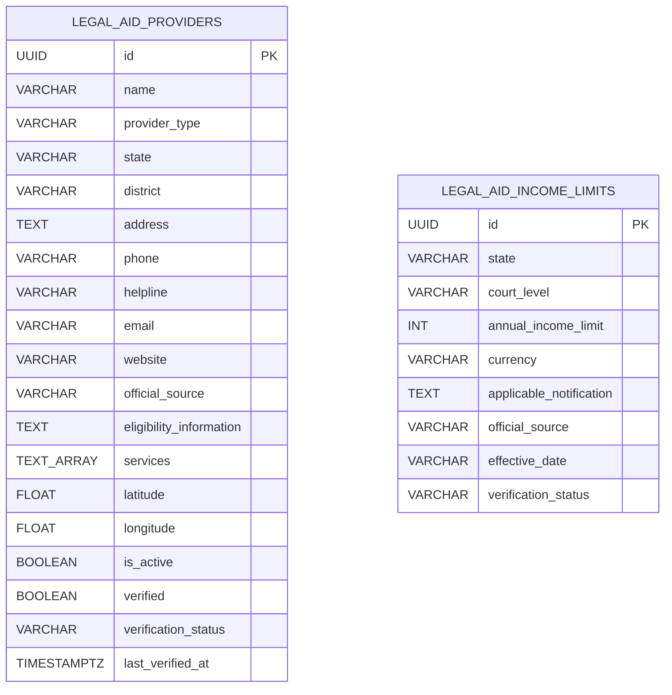

# NyayaSaathi (न्यायसाथी) — Legal Aid Provider Directory

## 1. Directory Structure & Provider Types

The Legal Aid Provider Directory provides verified records for official legal services authorities in India:

### Supported Provider Types:
- **`NALSA`**: National Legal Services Authority (Supreme Court Additional Complex, New Delhi).
- **`SCLSC`**: Supreme Court Legal Services Committee (Tilak Marg, New Delhi).
- **`SLSA`**: State Legal Services Authorities across all 28 States and 8 Union Territories.
- **`HCLSC`**: High Court Legal Services Committees located at High Court principal seats and permanent benches.
- **`DLSA`**: District Legal Services Authorities operating within District Court complexes across India.
- **`TLSC`**: Taluk / Sub-Divisional Legal Services Committees operating at the taluka level.

---

## 2. Directory Features & Constraints

### 2.1 No Invented Coordinates
In accordance with system requirements, provider coordinates (`latitude`, `longitude`) are only stored when verified from official court directory records. When coordinates are not verified, fields remain `null`. The directory **never generates fabricated coordinates**.

### 2.2 Manual State & District Navigation
Users can browse providers by manually selecting any State or District from responsive dropdowns **without being forced to grant browser location permissions**.

### 2.3 Direct Contact Actions
Every provider card surfaces:
1. **Direct Phone**: Tel link for official landlines/mobiles.
2. **National Helpline**: 15100 (24x7 toll-free) or 1516 (Delhi).
3. **Official Email**: Published government email for filing inquiries.
4. **Official Website**: Verified government link (`.gov.in` / `.nic.in`) protected by the external safety interstitial modal.
