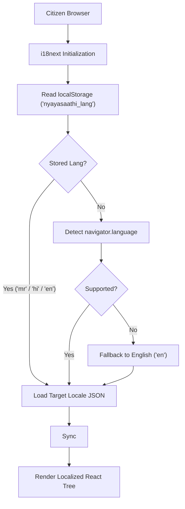

# NyayaSaathi (न्यायसाथी) Multilingual Architecture & Legal Translation

## 1. Executive Summary & Design Principles

NyayaSaathi is a citizen-first Know Your Rights (KYR) and Legal Aid platform built specifically for India's diverse demographic landscape. Linguistic inclusivity is critical: millions of citizens seeking legal remedies do not read or speak English comfortably.

Phase 15 establishes an enterprise-grade internationalization (i18n), localized speech, and statutory translation framework adhering strictly to **AGENTS.md Rule 6 (Zero Legal Hallucinations & Grounded Citations)** and **Rule 7 (Explicit Fallback Disclaimers)**.

### Core Architectural Axioms
1. **Separation of Statutory Authority and Explanation**: Statutory provisions (Acts, Sections, Gazette notifications) are immutable legal groundings. Official legal citations (`§` section symbols, Act names, notification dates) are strictly preserved across all languages.
2. **Tri-Language Foundation with Scalable Extensibility**: Comprehensive localized UI and statutory interpretations in **English (`en`)**, **Hindi (`hi`)**, and **Marathi (`mr`)**, designed for zero-code-change onboarding of other Schedule VIII languages (Tamil, Telugu, Bengali, Gujarati, Kannada, etc.).
3. **Transparent Translation Provenance**: Clear visible labeling separating **Human-Reviewed Legal Summaries** from **Machine-Generated Translations** (translated via Bhashini NMT).
4. **Resilient Local Client Caching & Fallback**: Browser `localStorage` persistence under key `nyayasaathi_lang` with automatic fallback to `en` if a localized key is missing.

---

## 2. Frontend Internationalization Framework

The internationalization layer is implemented in JavaScript ES Modules using `i18next` and `react-i18next`.

### 2.1 Configuration (`frontend/src/i18n/index.js`)
- **Initialization**: Asynchronous loader configured with `react-i18next`.
- **Supported Languages**: `['en', 'hi', 'mr']`.
- **Default Language**: `en`.
- **Fallback Language**: `en`.
- **Persistence**: Synced to `localStorage.getItem("nyayasaathi_lang")` on change; updates `document.documentElement.lang` dynamically to ensure screen readers adopt the correct phoneme sets.
- **Missing Key Handler**: Emits console warnings in development mode without crashing the UI, falling back directly to English key strings.

### 2.2 Locale Dictionary Organization
Structured identically across `en.json`, `hi.json`, and `mr.json`:
- `nav`: Top-level navigational links and branding.
- `hero`: Citizen landing page slogans, CTAs, and statutory disclaimers.
- `features`: Value propositions (KYR, Navigator, Legal Aid, Multilingual).
- `howItWorks`: 3-step citizen process guide.
- `stats`: Official figures (Sections indexed, States covered, NALSA helpline).
- `chat`: AI Legal Assistant interface, speech input status, read aloud actions.
- `rights`: Category discovery titles, conditions, remedies, and review status badges.
- `navigator`: Workflow cards, steps, document checklists, and safety confirmation modals.
- `aidFinder`: Legal aid directory, search filters, court hierarchies, and DLSA cards.
- `eligibility`: Rules engine questions, statutory exemption tags, income threshold evaluations.
- `accessibility`: Toolbar labels, font scaling, high contrast toggle, screen reader alerts.
- `common`: Universal strings (`loading`, `error`, `save`, `retry`, `helpline`).

---

## 3. Statutory Legal Translation & Citation Integrity

Legal translations carry strict legal liability. Translating legal terms verbatim using general-purpose translation engines can distort legal rights (e.g., translating "cognizable offense" as "knowable mistake").

### 3.1 Content Model Differentiation
In the NyayaSaathi data store and API layers, legal provisions are structured into 4 distinct fields:
1. **`original_statutory_text`**: Verbatim gazette text in official enactment language (predominantly English as published in India Code / Gazette of India).
2. **`simplified_explanation_en`**: Plain-English legal interpretation drafted for common citizens.
3. **`simplified_explanation_hi`**: Plain-Hindi legal explanation verified for statutory fidelity.
4. **`simplified_explanation_mr`**: Plain-Marathi legal explanation verified for statutory fidelity.

### 3.2 Machine Translation Transparency & Labeling
When content has not undergone formal vetting by an advocate or legal linguist, it is served through the Bhashini NMT translation pipeline and flagged:

| Badge Type | Visual Indicator | Metadata Contract | User Disclaimer |
|---|---|---|---|
| **Human-Reviewed** | Emerald Badge (`bg-emerald-50 text-emerald-800`) | `is_human_reviewed: true` | "Verified by legal team against Indian statutes." |
| **Machine-Generated** | Amber Badge (`bg-amber-50 text-amber-800`) | `is_human_reviewed: false` | "Translated via Bhashini NMT. Statutory citations §Section, Act Name strictly preserved. Verify with official Gazette." |

### 3.3 Statutory Citation Preservation Rule
Section references (`§ 12`, `Section 15(2)`, `Section 498A`) and Act titles (`Payment of Wages Act, 1936`, `Legal Services Authorities Act, 1987`) are isolated as protected tokens during translation to prevent machine translators from mutating legal identifiers into transliterated noise.

---

## 4. Multi-Language Switcher Component

Located in the global navbar (`frontend/src/components/layout/Navbar.jsx`):
- Accessible `<select>` dropdown with `aria-label="Select Language"`.
- Instant reactive switching via `i18n.changeLanguage(e.target.value)`.
- Updates `localStorage.setItem('nyayasaathi_lang', lang)` and updates root HTML document language attribute.
- Synchronizes with voice recognition and synthesis engines automatically.
