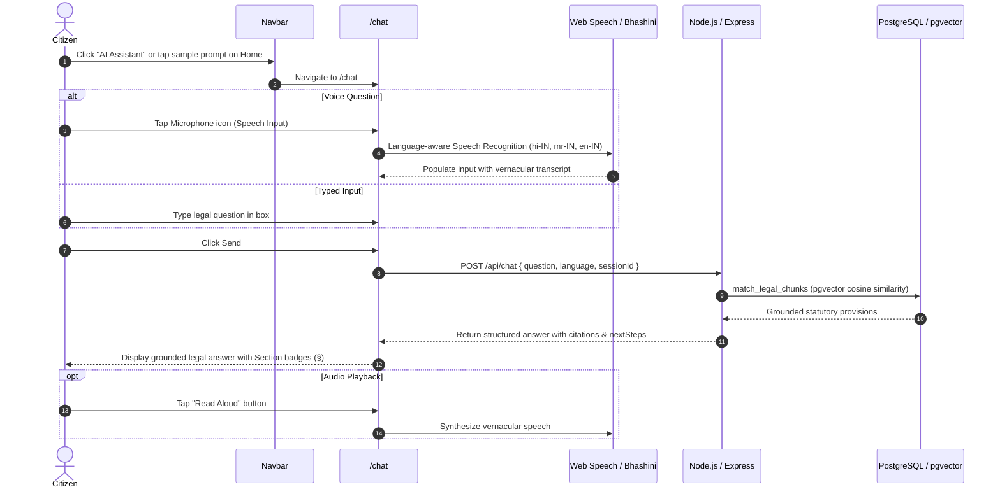
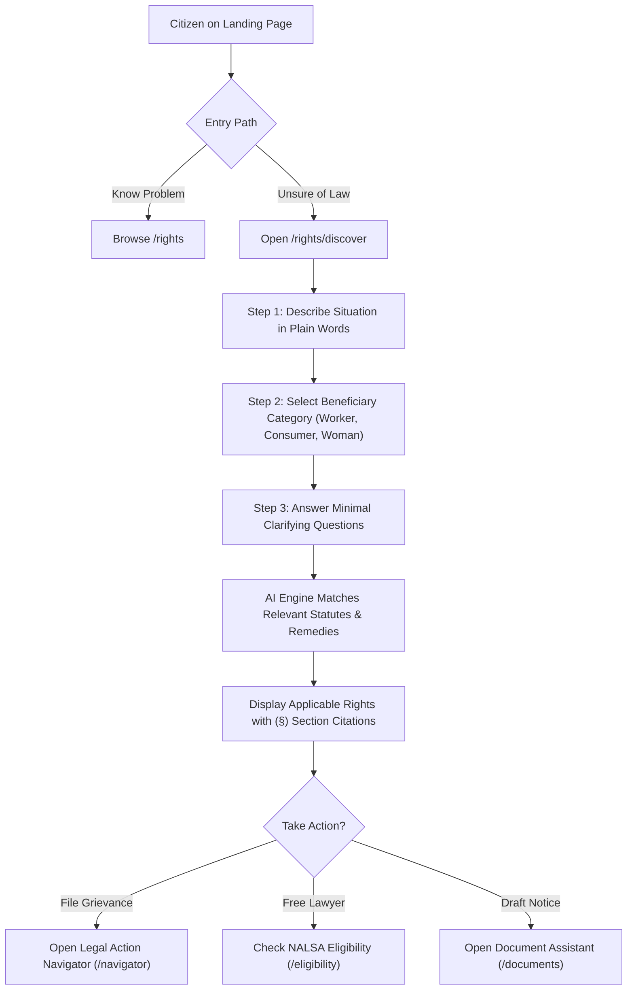
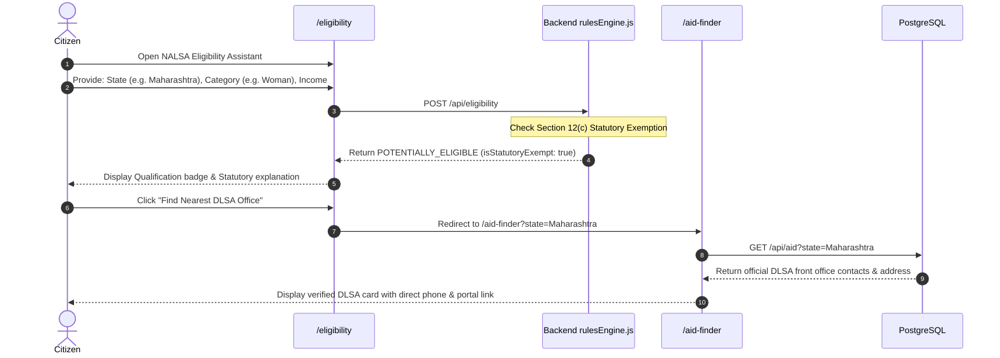
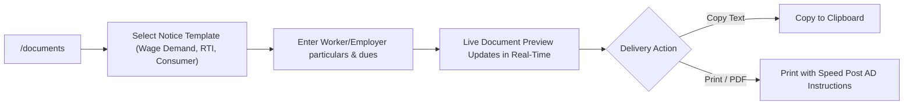

# NyayaSaathi (न्यायसाथी) Citizen User Journeys & Workflow Mapping

## 1. Journey 1: Legal Consultation & Conversational Inquiry

---

## 2. Journey 2: Guided Rights Discovery to Action Navigator

---

## 3. Journey 3: Free Legal Aid Qualification & Provider Matching

---

## 4. Journey 4: Statutory Legal Notice Drafting & Delivery

---

## 5. Journey 5: Citizen Dashboard Monitoring

1. **Dashboard Boot (`/dashboard`)**:
   - Fetches active user profile from `/api/auth/me`.
   - Fetches past conversation sessions from `/api/chat/sessions`.
   - Fetches active grievance workflow progress from `/api/workflows/user/all-progress`.
   - Fetches saved legal aid assessments from `/api/eligibility/assessments`.
   - Reads bookmarked rights from device local storage (`nyayasaathi_saved_rights`).
2. **Outcome**:
   - Single unified citizen cockpit tracking all ongoing legal journeys with zero data leakage between citizen accounts.
